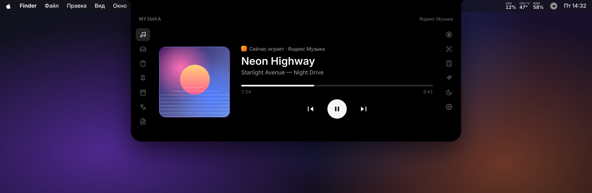
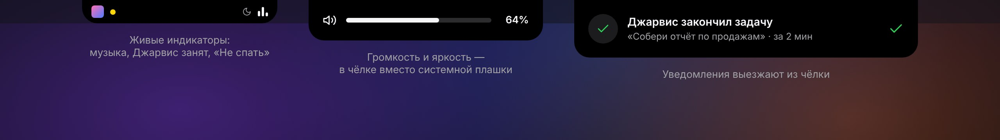
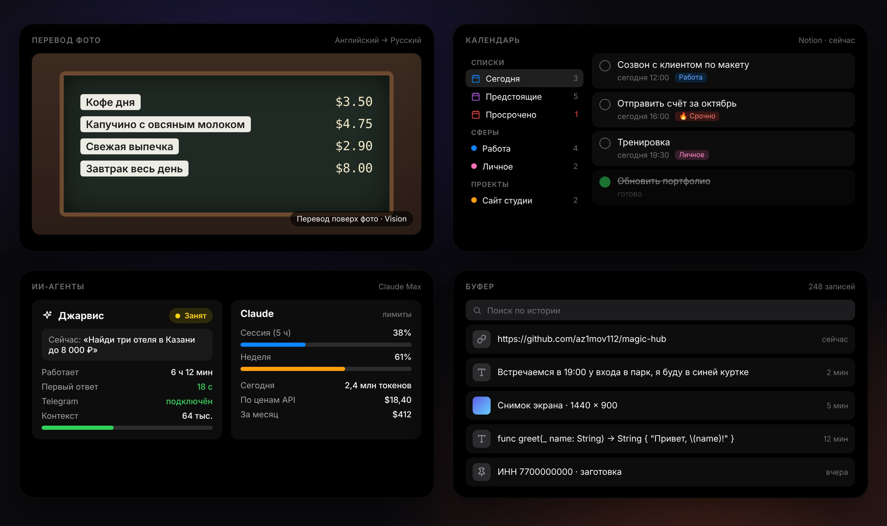
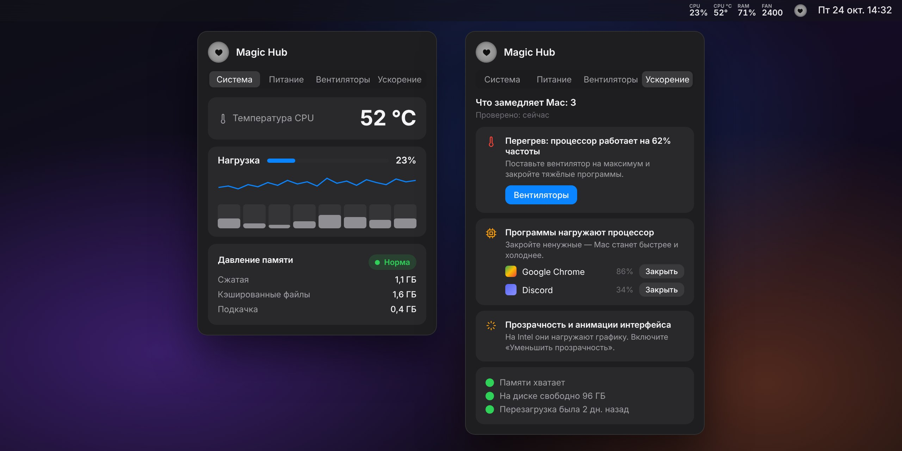

<p align="center">
  
</p>

<h1 align="center">Magic Hub</h1>

<p align="center">
  <b>Чёлка, которая умеет всё.</b><br>
  Музыка, буфер обмена, перевод, задачи, ИИ-агенты и здоровье Mac — в одной панели под вырезом экрана.
</p>

<p align="center">
  <a href="https://github.com/az1mov112/magic-hub/releases/download/nightly/MagicHub.zip">
    
  </a>
</p>

<p align="center">
  
  
  
  
</p>

<p align="center">
  
</p>

## Что это

Наведите курсор на верх экрана — из выреза (или из своей чёлки на Mac без выреза) выезжает панель с тринадцатью вкладками. Пока панель свёрнута, чёлка показывает, что играет, чем занят ваш ИИ-ассистент и не уснёт ли Mac, а уведомления и громкость появляются прямо в ней — как Dynamic Island на iPhone.

Родное приложение на Swift: весит около 3 МБ, почти не нагружает Mac и ничего никуда не отправляет.

<p align="center">
  
</p>

## Возможности

| | |
|---|---|
| 🎵 **Музыка** | Всё, что играет на Mac: Spotify, Яндекс Музыка, Apple Music, видео в браузере, голосовые в Telegram. Обложка, перемотка, пауза, переключение треков. |
| 🗂 **Полка и буфер** | История всего скопированного текста и каждый скриншот — с поиском. Клик — снова в буфере, можно перетащить в любое приложение. |
| 📌 **Заготовки** | Тексты, которые вы вставляете постоянно: реквизиты, адреса, шаблоны ответов. |
| 🗓 **Календарь** | Задачи из Notion с папками «Сегодня», «Предстоящие», «Просрочено», по сферам и проектам — или события Календаря Mac. Галочка закрывает задачу в Notion. |
| 🌐 **Перевод** | Живой перевод текста и перевод фото **прямо поверх картинки**: меню, вывески, документы. Google или Apple без интернета. |
| 📝 **Заметки, 💱 валюта, 🎬 телесуфлёр, 🧮 калькулятор** | Мелочи, которые всегда под рукой. Курсы — ЦБ РФ; телесуфлёр прокручивает текст прямо под камерой. |
| ✨ **ИИ-агенты** | Для тех, у кого есть Telegram-ассистент на Claude Code: жив ли он, чем занят, сколько думает, не переполнен ли контекст; перезапуск одной кнопкой. Лимиты подписки Claude и сколько это стоило бы по ценам API. |
| 🌙 **Не спать** | Mac не засыпает 15 минут, 8 часов или до отключения — в том числе **с закрытой крышкой**. Сам выключается, если батарея садится. |
| 🔊 **Громкость и яркость** | Красивая анимированная плашка в чёлке вместо системной. Подсветка клавиатуры — в настройках. |
| 📊 **Меню-бар** | Нагрузка и температура процессора, память, температура батареи, обороты вентилятора — каждое число включается отдельно. |
| ⚡ **Ускорение** | Честная проверка того, что тормозит Mac: перегрев и сброс частоты, тяжёлые программы, память, место на диске, давняя перезагрузка — с кнопками исправления. |

<p align="center">
  
</p>

<p align="center">
  
</p>

<sub>Картинки выше — макеты интерфейса с условными данными.</sub>

## Установка

1. **[Скачайте MagicHub.zip](https://github.com/az1mov112/magic-hub/releases/download/nightly/MagicHub.zip)** и распакуйте двойным кликом.
2. Перетащите **Magic Hub** в папку **Программы**.
3. Откройте его. При первом запуске macOS скажет, что не может проверить разработчика, — это нормально для приложений не из App Store:
   нажмите **Готово**, откройте  → **Системные настройки** → **Конфиденциальность и безопасность**, внизу нажмите **Всё равно открыть** и введите пароль.

<details>
<summary>Или одной командой в Терминале</summary>

```bash
xattr -dr com.apple.quarantine "/Applications/Magic Hub.app" && open "/Applications/Magic Hub.app"
```
</details>

Значка в Dock нет: Magic Hub живёт в чёлке и в меню-баре (сердечко и цифры справа). Все разрешения можно выдать разом: **Настройки → Разрешения → «Запросить все»**. Подробности — в [docs/INSTALL.md](docs/INSTALL.md).

**Требования:** macOS 15 Sequoia или новее, любой Mac — на Apple Silicon (M1 и новее) или на Intel.

## Обновления

Magic Hub обновляется сам. Когда выходит новая версия, из чёлки выезжает уведомление: нажмите на него — приложение скачает обновление, заменит себя и перезапустится за несколько секунд. Проверить вручную: **Настройки → Обновления → «Проверить»**.

Все версии подписаны одним сертификатом, поэтому после обновления выданные разрешения сохраняются.

## Разрешения и приватность

| Разрешение | Зачем | Обязательно? |
|---|---|---|
| Универсальный доступ | Своя плашка громкости и яркости вместо системной | Нет |
| Вставка из других приложений | История буфера обмена | Для буфера |
| Календарь | Вкладка «Календарь» в режиме «Календарь Mac» | Нет |
| Связка ключей | Лимиты Claude на вкладке «ИИ-агенты» | Нет |
| Пароль администратора, один раз | «Не спать» с закрытой крышкой и управление вентиляторами | Нет |

- **Всё остаётся на вашем Mac.** Буфер, заметки, скриншоты и настройки лежат в `~/Library/Application Support/MagicHub`. Никакой аналитики и телеметрии.
- В интернет приложение ходит только за тем, что вы сами включили: перевод (Google), курсы валют (ЦБ РФ), задачи из Notion, лимиты Claude, проверка сети по кнопке на вкладке «ИИ-агенты» и проверка обновлений на GitHub.
- Токен Notion хранится в Связке ключей macOS, а не в файлах.

## Вопросы

<details>
<summary><b>macOS пишет, что приложение повреждено или не удаётся проверить разработчика</b></summary>

У Magic Hub нет платной подписи Apple — это бесплатный проект не из App Store. Разрешите запуск один раз, как описано в «Установке», или выполните команду из спойлера там же.
</details>

<details>
<summary><b>У меня Mac без выреза — будет работать?</b></summary>

Да. На экранах без выреза Magic Hub рисует свою аккуратную чёлку. Стиль можно выбрать в настройках: «Авто», «Широкая» или «Под вырез».
</details>

<details>
<summary><b>Чёлка открывается сама, когда я веду мышь вверх</b></summary>

Настройки → Чёлка → «Открывать панель» → «Кликом». Там же меняется размер панели.
</details>

<details>
<summary><b>Мне не нужны ИИ-агенты, календарь или телесуфлёр</b></summary>

Настройки → Разделы: любую вкладку можно скрыть. Если Telegram-ассистента на Mac нет, Magic Hub просто показывает «Не найден» и почти не тратит ресурсы на его поиск.
</details>

<details>
<summary><b>Не нагрузит ли это мой старый Mac?</b></summary>

На Intel и в режиме энергосбережения автоматически включается экономный режим: датчики опрашиваются реже, а анимации в чёлке замирают. Его можно включить и вручную: Настройки → Общее → «Экономный режим».
</details>

<details>
<summary><b>Что-то работает не так</b></summary>

Настройки → в самом низу «Диагностика» → «Скопировать». В отчёте нет текста переписки, токенов и содержимого задач — только технические сведения. Пришлите его вместе с описанием проблемы в [Issues](https://github.com/az1mov112/magic-hub/issues).
</details>

<details>
<summary><b>Как удалить</b></summary>

Сердечко в меню-баре → «Выйти», затем удалите приложение из «Программ» и папку `~/Library/Application Support/MagicHub`. Если ставили помощника для закрытой крышки или вентиляторов, сначала удалите его кнопкой в настройках.
</details>

## Для разработчиков

Нужен Mac с Xcode 16 или новее:

```bash
git clone https://github.com/az1mov112/magic-hub.git
cd magic-hub
./scripts/bundle.sh        # → build/Magic Hub.app и build/MagicHub.zip
```

| Путь | Что там |
|---|---|
| `Sources/MagicHub/App` | запуск, значок в меню-баре |
| `Sources/MagicHub/Core` | настройки, тема, общие элементы, утилиты |
| `Sources/MagicHub/Notch` | окно-чёлка, наведение, анимации, панель |
| `Sources/MagicHub/Features/*` | вкладки и сервисы |
| `Sources/MediaRemoteBridge` | мост «Сейчас играет» (загружается системным perl) |

Каждый коммит собирает GitHub Actions: универсальная сборка для Apple Silicon и Intel публикуется в [Releases → nightly](https://github.com/az1mov112/magic-hub/releases/tag/nightly), откуда её и забирает встроенное обновление. Техническое задание — [docs/SPEC.md](docs/SPEC.md), устройство мониторинга ИИ-ассистента — [docs/JARVIS_ARCHITECTURE.md](docs/JARVIS_ARCHITECTURE.md).

Правила репозитория: никаких токенов, ключей, личной переписки и логов в коммитах; пути и настройки не захардкожены — всё определяется автоматически или задаётся в приложении.

<p align="center"><br>Сделано с 🖤 для своих.</p>
